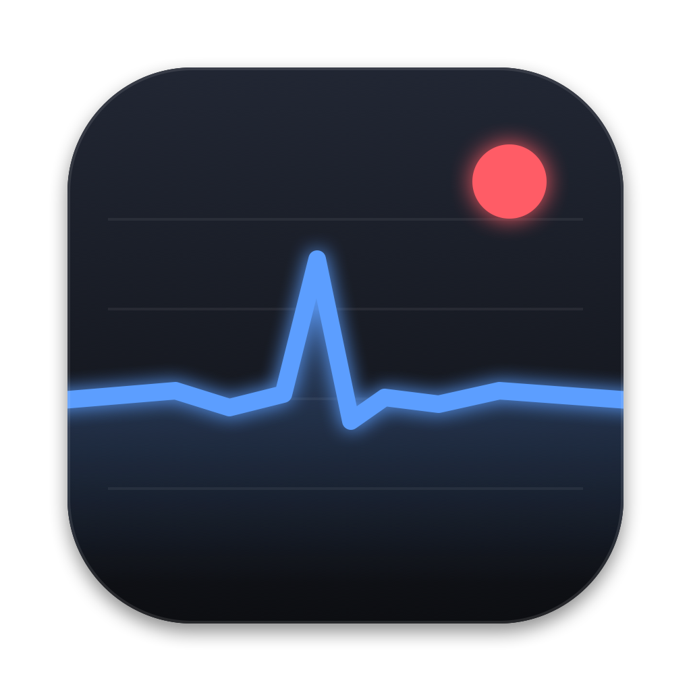
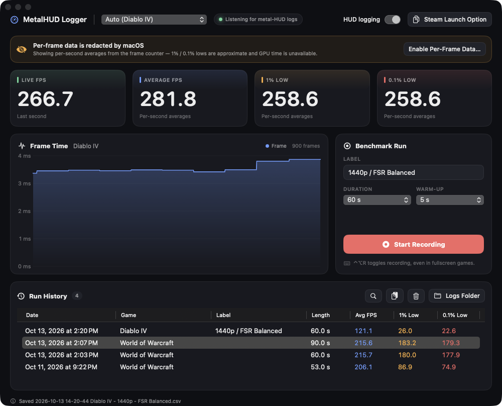

<p align="center">
  
</p>

<h1 align="center">MetalHUD Logger</h1>

<p align="center">
  Benchmark macOS games using Apple's built-in Metal Performance HUD: live FPS, 1% / 0.1% lows,
  frame-time graph, and recorded runs saved as CSV.
</p>

<p align="center">
  
</p>

## Features

- **Live stats** — current FPS, average FPS, 1% low and 0.1% low for the game in focus.
- **Frame-time graph** of the last 900 frames (with GPU time when available).
- **Benchmark runs** — fixed-length or manual recordings with an optional warm-up, saved as a per-frame CSV plus a text summary.
- **Global hotkey ⌃⌥R** starts and stops recording, even while a game is fullscreen.
- **Automatic game detection** — any Metal app writing HUD logs shows up, including Windows games running through Wine / Game Porting Toolkit (named after their `.exe`).
- **Run history** with quick access to files and copyable summaries.

## How it works

When `MTL_HUD_ENABLED=1` and `MTL_HUD_LOG_ENABLED=1` are set for a process, Metal's HUD (`libMTLHud`) writes a
`metal-HUD:` line to the unified log about once a second. MetalHUD Logger runs `log stream`, parses those lines and
computes statistics. No injection, no special entitlements, no Accessibility permission.

## Requirements

- macOS 13 Ventura or later
- Swift 5.9+ toolchain (Xcode or Command Line Tools) to build

## Build

```bash
./build.sh
```

This builds a release binary, wraps it in `MetalHUD Logger.app` with the icon, and ad-hoc signs it.
For development you can also use `swift run`.

The icon is generated by `swift Scripts/make-icon.swift`.

## Usage

1. Turn on **HUD logging** in the top bar. This sets the HUD variables with `launchctl setenv`, so it only affects
   apps launched *afterwards* — relaunch the game (and Steam, if you use it).
   - For Steam games you can instead paste the launch option from **Steam Launch Option**:
     `MTL_HUD_ENABLED=1 MTL_HUD_LOG_ENABLED=1 %command%`
   - Wine launchers (CrossOver, Whisky, custom ones) must pass both variables through to the game's environment.
2. Launch the game. It appears in the game picker; **Auto** follows the most recently started one.
3. Set a label, duration and warm-up, then press **Start Recording** or ⌃⌥R.

Runs are saved to `~/Documents/MetalHUD Logs/` as `<date> <game> - <label>.csv` and `_summary.txt`.

### Per-frame data and the `<private>` redaction

macOS redacts the per-frame part of each HUD log line as `<private>`. Without it, MetalHUD Logger estimates frames
from the per-second frame counter, so 1% / 0.1% lows are approximate and GPU time is unavailable (an orange banner
says so).

**Enable Per-Frame Data…** generates a configuration profile that turns off private-data redaction in the unified
log. Install it in **System Settings › General › Device Management**. Note that this affects *all* log messages on
the Mac; remove the profile there to undo it.

## License

MetalHUD Logger is free software, licensed under the [GNU General Public License v3.0](LICENSE).
